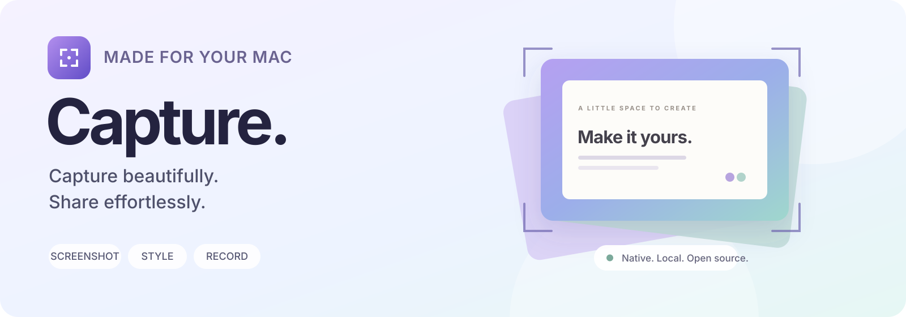
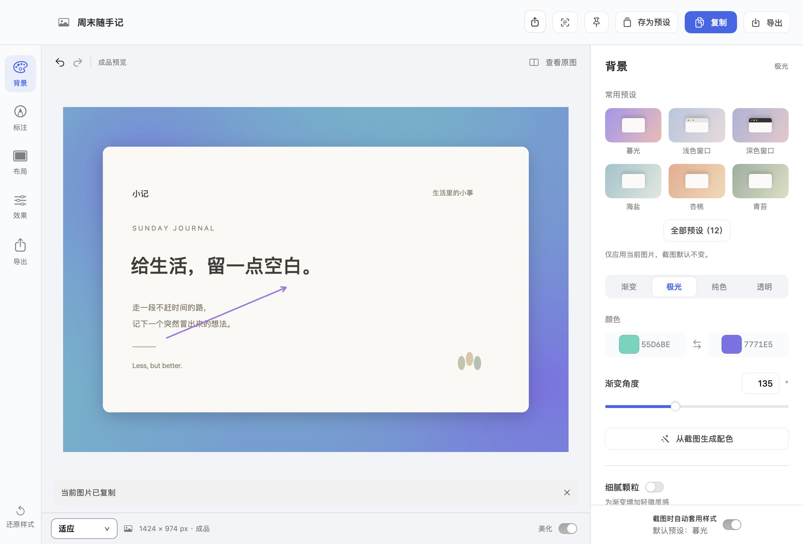
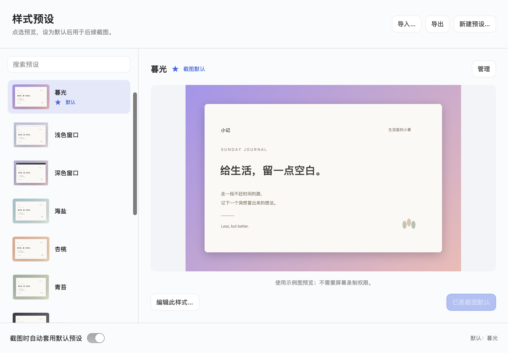
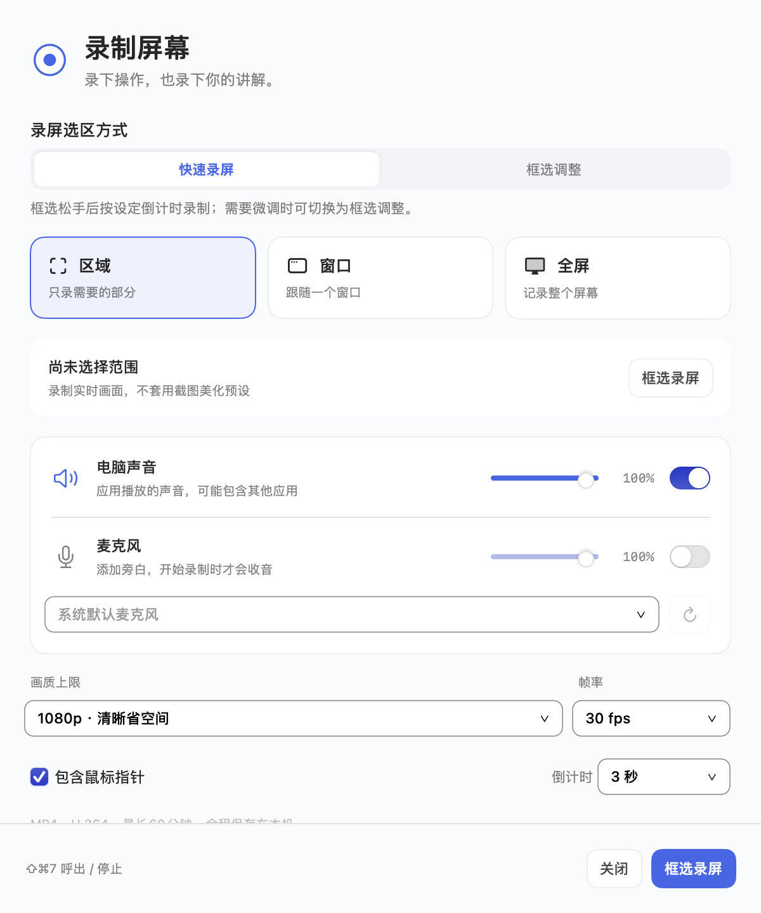

<div align="center">



# Capture beautifully. Share effortlessly.

A native macOS app for capturing, styling and sharing what is on your screen.

[简体中文](README.md) · **English**

[](docs/distribution.md)
[](https://github.com/why-evolving/capture/releases/tag/v0.6.2)
[](https://github.com/why-evolving/capture/releases/tag/v0.6.2)
[](LICENSE)

**[↓ Download for Mac](https://github.com/why-evolving/capture/releases/download/v0.6.2/Capture-0.6.2-mac-arm64.zip)** · [All releases](https://github.com/why-evolving/capture/releases) · [Quick start](#quick-start) · [Documentation](docs/README.md)

</div>

<br>



<p align="center"><sub>Actual app UI · App-generated sample content · The current app interface is primarily in Chinese</sub></p>

## A shorter path from capture to share

| Capture a moment | Make it your own | Record the process |
| --- | --- | --- |
| Open with a shortcut, freeze the scene and select. Copy immediately or move and resize before confirming. | Add backgrounds, padding, corners, shadows and window frames. Save a favorite combination as your default. | Select directly with a separate shortcut, then count down to recording. Control system audio and microphone independently. |

### Keep the moment still

- **Frozen selection** preserves the scene when selection begins, including hover menus and temporary states.
- **Quick or precise**: capture a region, window or full screen. Switch between immediate capture and an adjustable selection; drag inside, resize at the edges and press Return to confirm.
- **Ready to paste**: copy automatically, then use the thumbnail to edit, save or pin the image.
- **Organize longer content** with scrolling capture and collage tools.

### Give every screenshot a style

- Gradient, aurora, solid, transparent and image backgrounds, with padding, rounded corners and shadows.
- Light or dark Mac window decorations; extract a palette from your screenshot or choose your own colors.
- Multiple named presets with previews, search, import and export. Set one as the default and apply it automatically to new captures.
- Adjust styling beside the selection, or turn automatic styling off for plain screenshots.
- Copy and export share the same final render. Preview zoom does not determine export resolution; 100% preserves source pixels.

<details>
<summary><strong>Explore the preset manager</strong></summary>
<br>

</details>

### Annotate, extract and keep editing

Arrows, text, freehand drawing and redaction, with cropping, undo and redo. Extract text with OCR and pin images for reference. Save an editable `.capture` project or enable optional local history.

> Redaction does not remove the original image from an editable project. Share a copied or exported finished image rather than a project that still contains the original.

### Record quickly, with room to fine-tune

<table>
<tr>
<td width="54%" valign="top">

**Start with a selection**<br>
Use the recording shortcut and drag a region. Releasing the mouse starts the configured countdown with your remembered settings.

**Adjust when you need to**<br>
Switch to adjustable selection, move the frame, resize using its eight handles and press Return to begin. Cancel the countdown or return to adjustment at any time before recording starts.

**Choose what gets recorded**<br>
Record a region, window or full screen. Toggle system audio and microphone separately, adjust their volumes, and choose the microphone device, resolution limit, frame rate, cursor visibility and countdown.

**Finish and share**<br>
Pause, resume, stop, preview, save and recover local MP4 recordings. Video captures the live scene; static screenshot styling is not applied to recordings.

</td>
<td width="46%" align="center">

</td>
</tr>
</table>

## Quick start

1. **[Download the v0.6.2 preview](https://github.com/why-evolving/capture/releases/tag/v0.6.2)**, unzip it and move `Capture.app` into Applications. Xcode is not required to run the app.
2. Open Capture and use its menu bar item. Follow the welcome screen to grant screen recording access. Grant microphone access only if you want to record it, and relaunch if macOS requests it.
3. Use the screenshot shortcut, select a region and paste. Open the resulting thumbnail when you want to edit.

| Action | Default shortcut |
| --- | --- |
| Capture a region | <kbd>⇧ Shift</kbd> + <kbd>⌘ Command</kbd> + <kbd>2</kbd> |
| Open recording / stop an active recording | <kbd>⇧ Shift</kbd> + <kbd>⌘ Command</kbd> + <kbd>7</kbd> |
| Confirm an adjusted selection | <kbd>Return</kbd> |
| Cancel selection | <kbd>Esc</kbd> |

Both global shortcuts can be changed independently in Settings. To reuse a style, select a preset, make it the default and enable automatic styling for new screenshots.

> [!IMPORTANT]
> This is an **Apple Silicon preview** declaring macOS 14 as the minimum. Older systems and all hardware combinations have not been fully validated. The app is **not Developer ID signed or notarized by Apple**. If macOS blocks a trusted download, try opening it first, then choose Open Anyway in System Settings → Privacy & Security. See [Apple's guide](https://support.apple.com/en-us/102445) and the [installation notes](docs/distribution.md).

<details>
<summary>Verify your download</summary>

Download the ZIP and its `.zip.sha256` file from the same release. In their directory, run:

```sh
shasum -a 256 -c Capture-0.6.2-mac-arm64.zip.sha256
```

`OK` confirms the file matches the supplied checksum. Get both files from this repository's Release page.

</details>

## Keep it local

Screenshots, recordings and OCR are processed on your Mac. No account or project-operated cloud service is required. Local history is optional, and you choose destinations in the system share sheet. macOS manages screen and microphone permissions.

**Not available yet:** Intel, Windows or iOS builds; GIF recording; camera picture-in-picture; video editing; video background styling; cloud sharing links. Features described here are available in the current app; future requirements are not a promise of implemented functionality.

## For developers

SwiftUI + AppKit UI, ScreenCaptureKit capture, Vision OCR and AVFoundation media processing. **No external Swift package dependencies.**

Use an Apple Silicon Mac with Swift 6 and Command Line Tools or Xcode:

```sh
git clone https://github.com/why-evolving/capture.git
cd capture
zsh scripts/test.sh
swift build -c release
```

To build a runnable `.app`, prepare and pin your own local signing identity first:

```sh
python3 scripts/signing.py setup
zsh scripts/build.sh .build/release-candidate
open .build/release-candidate/Capture.app
```

Signing setup may require Keychain confirmation. See [CONTRIBUTING.md](CONTRIBUTING.md) for build, verification and contribution details.

| Explore | Links |
| --- | --- |
| Product and interaction | [Requirements](docs/product/requirements.md) · [UI specification](docs/design/ui-spec.md) |
| Engineering and validation | [Technical design](docs/engineering/technical-design.md) · [Test plan](docs/testing/test-plan.md) · [CI](https://github.com/why-evolving/capture/actions) |
| Releases and collaboration | [Changelog](CHANGELOG.md) · [Distribution](docs/distribution.md) · [Report an issue](https://github.com/why-evolving/capture/issues) |
| Security and provenance | [Security policy](SECURITY.md) · [Third-party notices](THIRD_PARTY_NOTICES.md) · [Showcase image sources](docs/assets/readme/README.md) |

Supporting documentation is currently primarily in Chinese. Use app-generated examples when reporting issues; do not upload personal screenshots, recordings, secrets or projects containing unredacted originals. Maintenance is best effort. Feedback and contributions are welcome.

## License

[**AGPL-3.0-only**](LICENSE). Commercial use and paid distribution are permitted. Distribution of covered software requires corresponding source under the license; modified versions offering network interaction also fall under Section 13. See [NOTICE](NOTICE) and the [Chinese explanation](LICENSE.zh-CN.md).

---

<p align="center"><sub>Capture · Native macOS · Your captures, in your hands.</sub></p>
